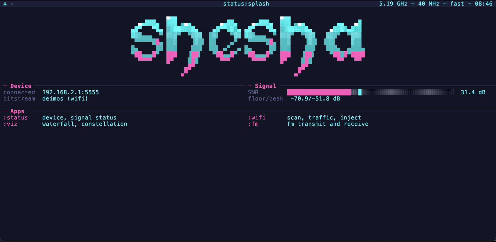
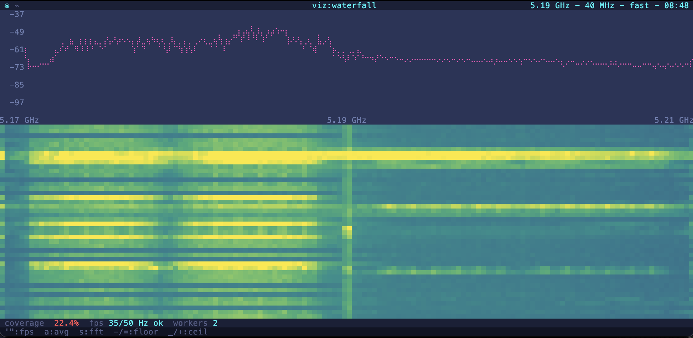
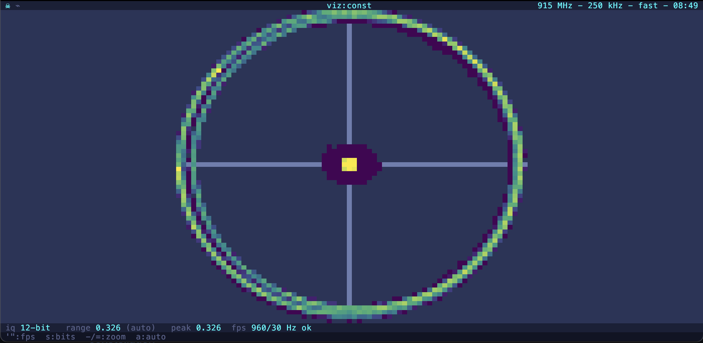
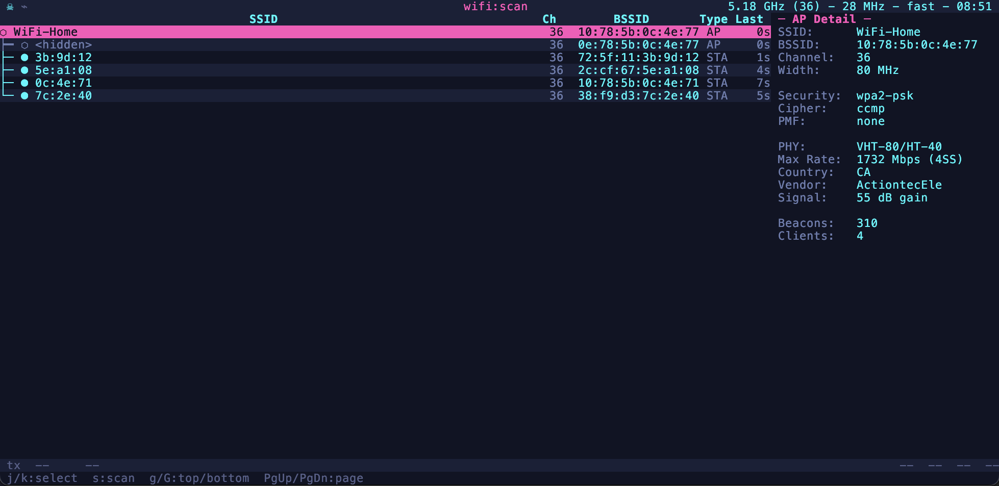
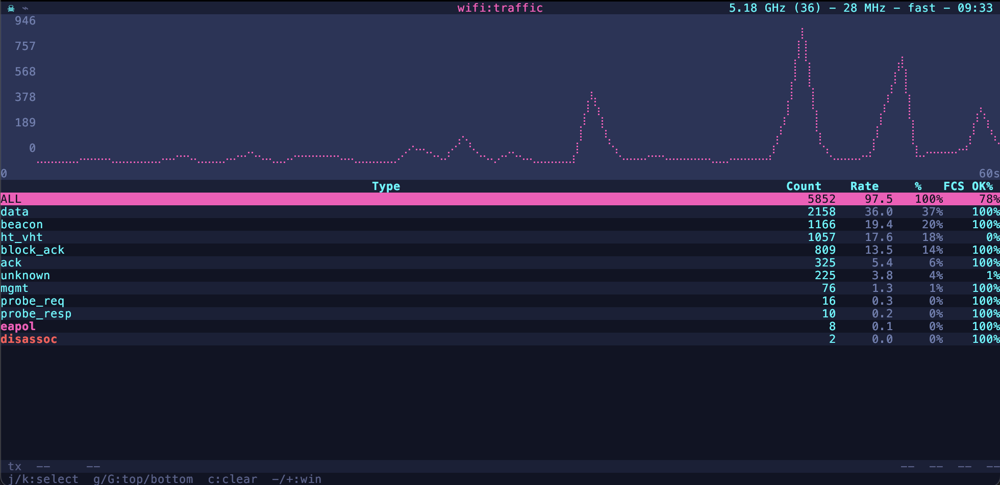
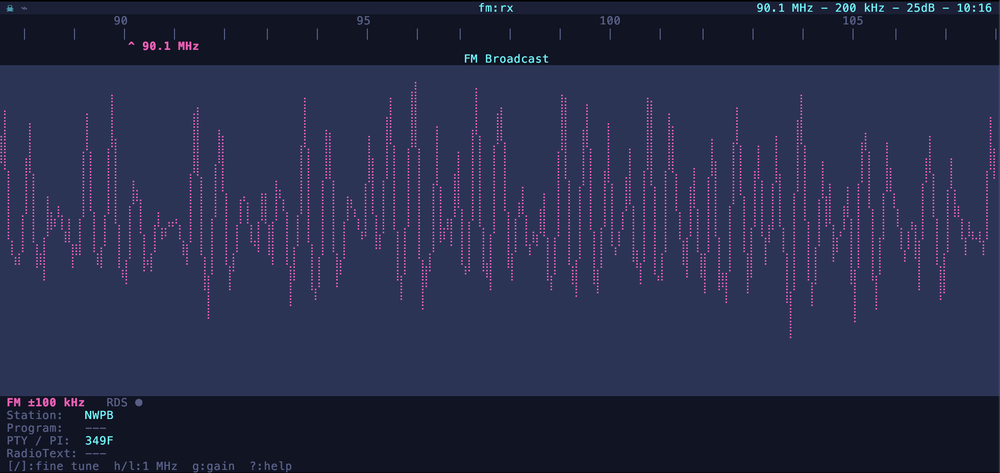
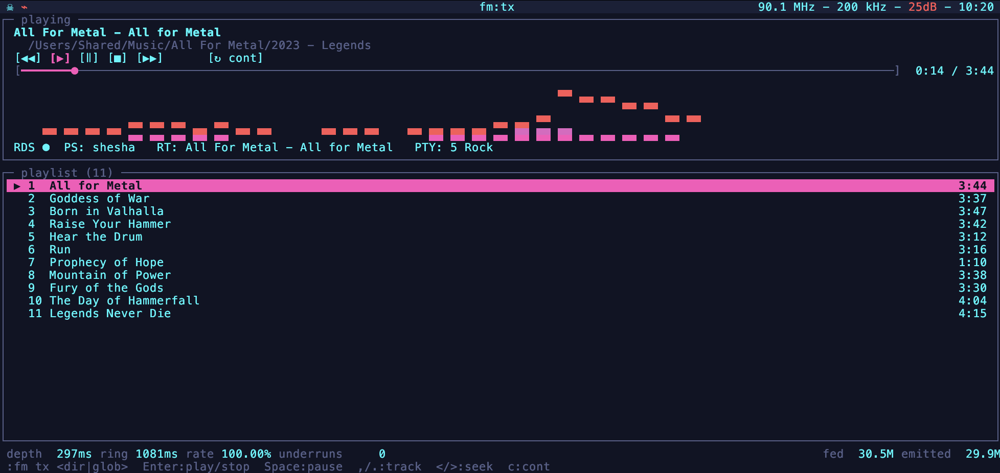

# SheshaSDR
A firmware daemon and host-side clients for the PlutoSDR running [styx](https://github.com/smar10s/styxsdr)-based bitstreams. Replaces the stock IIO interface with a protocol-based one: IQ is captured and processed on the device, and symbol-level data is streamed to the host.

The goal is to do all the processing on device, and turn the Pluto into a self-contained radio server, with only thin clients connecting. A daemon captures IQ, processes it (FFT, WiFi decode, etc.), and streams results over TCP to a client. A client is anything that speaks the binary TLV protocol. Included are a TUI, a CLI, and Python and C examples.

The daemon selects one mode at a time. The producer for that mode processes IQ and returns bytes to consumers. For example, when in WiFi mode, the data stream is PSDU+tag info. Transmission is via mode-specific commands.

Clients can select modes, tune the radio, configure mode-specific settings, and send data.

Bitstreams can add hardware acceleration to existing modes. Currently there is only one: [deimos](https://github.com/smar10s/deimossdr) for WiFi.

## Status

Pre-1.0. The wire protocol, client API, and command set may change without notice. Firmware and clients must be built from the same commit; there is no protocol version negotiation.

## Install

### Requirements

**Pluto**
- PlutoSDR with a styx-compatible bitstream flashed. Use [styx](https://github.com/smar10s/styxsdr) for all modes, or [deimos](https://github.com/smar10s/deimossdr) to add fabric WiFi decode.
- Both cores online (`nproc` reports 2). The stock image boots with one: run `fw_setenv maxcpus 2` and reboot, or enable CPU1 immediately with `echo 1 > /sys/devices/system/cpu/cpu1/online`.
- SSH access from the host. Defaults are `root@192.168.2.1`; override with `PLUTO_IP`, `PLUTO_USER`, and `PLUTO_PASS`.

**Build host**
- `make` and `git`, with the top-level submodules initialized (`git submodule update --init`; nested submodules are unused).
- Docker, for the ARM cross-compile.
- A local `styx-firmware` Docker image (see Build & Run below).
- OpenSSH (ssh, scp) and sshpass, for `make deploy` and `make run`.

**Client**
- Python 3.12+ and pip. The client is stdlib-only aside from the external tools below.
- ffmpeg, to decode audio files for FM transmit.
- An audio player for FM receive: ffplay, sox (play), or aplay.

### Build & Run

Flash a styx/deimos bitstream and bring CPU1 online first (see Requirements).

```sh
git clone https://github.com/smar10s/shesha.git
cd shesha
git submodule update --init

# one-time: build the cross-compile image (top-level make assumes it exists)
docker build -t styx-firmware -f firmware/platforms/styx/firmware/docker/Dockerfile firmware/platforms/styx/firmware/docker/

make                 # cross-compile daemon
make deploy          # copy to Pluto /usr/bin
make run             # start daemon on :5555

# install the Python client (TUI + CLI).
cd client && pip install -e .
shesha               # TUI; `shesha status` for CLI
```

The Pluto rootfs is volatile: re-run `make deploy` and `make run` after a power cycle.

## Usage

Basic IQ capture in Python and C:

**Python** ([examples/iq_rx.py](examples/iq_rx.py)):

```python
from shesha.client import DaemonClient
from shesha.protocol import DaemonMode, SUBSCRIBE_IQ

client = DaemonClient("192.168.2.1", 5555)
client.connect()
client.set_mode(DaemonMode.IQ)
client.set_freq(90_100_000)
client.subscribe(SUBSCRIBE_IQ)
for frame in client.iq_rx():
    print(frame.timestamp, frame.freq_mhz, frame.n_samples)
    break
client.disconnect()
```

**C** ([examples/iq_rx.c](examples/iq_rx.c)): build with `make examples`, then run `build/examples/iq_rx`.

```c
#include <stdio.h>
#include "shesha/client.h"

shesha_client_t *c = shesha_client_new();
shesha_client_connect(c, "192.168.2.1", SHESHA_DEFAULT_PORT, 2.0);
shesha_client_set_mode(c, SHESHA_MODE_IQ);
shesha_client_set_freq(c, 90100000);
shesha_client_subscribe(c, SHESHA_SUBSCRIBE_IQ);

shesha_iq_frame_t f;
if (shesha_client_iq_rx_next(c, &f, 1000) == 1) {
    printf("%u samples\n", f.n_samples);
    shesha_iq_frame_free(&f);
}
shesha_client_free(c);
```

**pygame** ([examples/pygame_waterfall.py](examples/pygame_waterfall.py)): PSD mode and a pixel buffer to render a waterfall.

```python
from shesha.client import DaemonClient
from shesha.protocol import DaemonMode, MsgType, SUBSCRIBE_PSD, parse_psd

client = DaemonClient("192.168.2.1", 5555)
client.connect()
client.set_mode(DaemonMode.WATERFALL)
client.set_freq(90_100_000)
client.subscribe(SUBSCRIBE_PSD)

for kind, payload in client.recv_raw(timeout=1.0):
    if kind == MsgType.DATA_PSD:
        bins = parse_psd(payload).bins   # draw it however you like
```

Install the optional renderer with `pip install -e 'client[waterfall]'`, then run `python3 examples/pygame_waterfall.py --freq 90.1`.

## Modes

### IQ
Raw streaming IQ using the ASIC decimator.

Features:
- Full-duplex streaming TX and RX.
- 12-bit (3 B/sample) or 8-bit (2 B/sample) wire format, selectable at runtime.
- 2.1-6 MSPS; 16K-sample frames.
- Removes the stock Xilinx AXI-DMA [`MAX_TRANS_LEN`](https://github.com/Xilinx/linux-xlnx/blob/master/drivers/dma/xilinx/xilinx_dma.c) limit.

Caveats:
- USB2 one-way ceilings are ~15 MB/s at 8-bit and ~19.5 MB/s at 12-bit. Duplex admission uses a single 16 MB/s combined RX+TX budget; the policy caps IQ at 6 MSPS (12 and 18 MB/s of payload).
- Concurrent TX is admitted only when it fits: 8-bit 4+4 works, 12-bit 4+4 is refused.
- ASIC decimator only -- the styx bitstream provides no fabric FIR.
- Unlike libiio there is no buffering; it is a straight capture/stream path.

### PSD
FFT spectrum and waterfall.

Features:
- On-device FFT with selectable size, window (rect, Hann, Blackman-Harris, flat-top), and accumulation.
- Only PSD bins are sent to the host, so the full ~56 MHz span is viewable over USB2, at reduced "coverage".
- Supports two workers on both cores, running concurrently on disjoint blocks.

Caveats:
- Software FFT only; there is no fabric FFT accelerator (for that see [maia-sdr](https://github.com/maia-sdr/maia-sdr)).
- CPU cost and therefore coverage scale with sample rate: full coverage up to ~5-7 MSPS depending on FFT size; falls above that. See [docs/psd-waterfall.md](docs/psd-waterfall.md) for details.
- No host-side buffering: the producer transforms what it can and skips the rest, so coverage falls below 100%; the stream stays real-time.
- The second worker only runs above [fs_max](firmware/src/wf_workers_policy.c). Below that, one core is at least as fast.

### FM
FM broadcast receive and transmit. Wideband only for now.

Features:
- Receive broadcast audio.
- Transmit audio from files or folders, with adjustable deviation (75 kHz default).
- Decode RDS: station name, program type, PI, radiotext, clock, alternate frequencies, and ODA.
- Transmit RDS: station ID, name, program type, radiotext.

Caveats:
- Mono only; there is no stereo decoder yet.
- Wideband FM only; no narrowband mode.
- RDS decoding needs program audio present in the signal.

More: [RX](docs/fm-rx.md) and [TX](docs/fm-tx.md).

### WiFi
20 MHz legacy rate 802.11a/g PHY.

Features:
- Decodes all legacy rates (6-54 Mbps) in software using [lib80211](https://github.com/smar10s/lib80211).
- The [deimos](https://github.com/smar10s/deimossdr) fabric accelerator decodes 6-36 Mbps in real time; 48/54 decode correctly but are not real-time.
- Host-side deep frame parsing, AP and station aggregation, OUI vendor lookup, and PCAP export.
- Beacon and arbitrary-PSDU transmit with one-shot, counted, continuous, or hardware-cyclic scheduling.
- Channel scan with dwell, channel hopping, and AP grouping.

Caveats:
- No HT/VHT support. Hardware-limited, and legacy covers the overwhelming majority of decodable management and control frames.
- Decoupled RX and TX: you can transmit and receive, but there is no state or trigger mechanism between them. Sending beacons works; ACKing a received frame does not.
- RX duty depends on the accelerator. Software decode is not real-time: it captures 20 ms of IQ per ~170 ms capture/decode cycle, so it listens to only ~10% of the airtime. The exact ratio varies with channel conditions and rate mix.

## CLI

`shesha` is the headless client for scripting and quick checks. Global `--host` and `--port` options select the daemon, and most commands take `--json`.

```sh
shesha status
shesha status caps
shesha radio freq 90.1
shesha radio bw 2.1
shesha radio gain 40
shesha viz fft 4096
shesha viz capture --duration 5 --out psd.jsonl
shesha wifi scan --duration 15
shesha wifi tx beacon --ssid test --channel 6
shesha fm rx --freq 90.1 --wav out.wav
shesha fm tx --freq 90.1 --file track.mp3
shesha iq rx --out capture.bin --freq 90.1 --sr 2.1
shesha iq tx --file capture.bin --freq 90.1 --sr 2.1
shesha debug cpu
```

Command groups: `status`, `radio`, `viz`, `wifi`, `fm`, `iq`, `debug`. Run `shesha <group> --help` for options.

Run `shesha` with no arguments to open the TUI, or `shesha tui` to open it explicitly with TUI flags such as `--offline`.

## TUI
A vim-inspired client: normal mode interacts with the main panel, command mode for commands. The TUI is a shell organized into apps that implement their own views and commands.

Press keys in normal mode to interact with the shell. Some keys support numeric prefixes. For example, `50g` sets gain to 50 dB. Some keys like `h`/`l` for tuning are global, apps define their own on top.

Press `:` to enter command mode. Global commands and app names are always available. Apps can implement their own commands and keys.

Configuration and UI state live in `$SHESHA_CONFIG_DIR/config.json` if set, else `$XDG_CONFIG_HOME/shesha/config.json`, else `~/.config/shesha/config.json`. You can edit this by hand or with the `set` command: `:set key value`. `get` returns the current value.

You can see all available config options, keys and commands for a given app using `:help` or pressing `?`. This also shows the global options still available.

The client will automatically try to connect to a running daemon on 192.168.2.1:5555. Use `:daemon` for daemon control, or `:connect` to automatically deploy, start and connect as needed. The TUI's deploy commands run the repo Makefile, so install the client editable (`cd client && pip install -e .`) from a source checkout.

The status bar at the top shows:
- Daemon connection status.
- Transmitter status.
- Current app:view.
- Current frequency, bandwidth and gain.

### Status

`:status`

Shows radio and daemon state.



### Viz

`:viz waterfall`



`:viz const`



### WiFi

WiFi monitor and transmitter.

In the WiFi app, `:record [--eapol] [file]` writes a PCAP; `--eapol` keeps only EAPOL frames.

`:tx` currently supports beacons and arbitrary frames, e.g. `:tx beacon hacktheplanet`.

`:wifi scan`
Scans for APs and STAs on the selected channel. 's' to cycle through channels automatically. Set dwell time with `wifi.scan.dwell`. If using deimos, `:fpga on|off` to toggle hardware vs software decoder.



`:wifi traffic`
Shows all traffic on the selected channel by type.



### FM

`:fm rx`
FM receiver. Coarse 1 MHz tune with regular keys, `[`/`]` for finer control.



`:fm tx`
FM transmitter with playlist support. Add files or folders with `:fm tx foo.mp3`. Enter to play/stop, space to pause. Supports RDS (`:fm rds on|off`; set a station ID first with `:fm rds pi <hex>`) and ID3-derived RDS (`:set fm.tx.rds.from_id3 true` with RDS on).



## Transmitting

You are responsible for your transmitter. Be nice and pay attention.

## License

The original source in this repository is MIT. The OUI vendor table in
`client/shesha/oui.py` is generated from Wireshark's GPL-2.0-or-later
manuf data and is included under that license; the rest of the client
remains MIT. See [LICENSE](LICENSE).

The daemon links FFTW, which is GPL-2.0-or-later (or commercially licensed). Distributed binaries that include FFTW are therefore GPL-2.0-or-later. The source for those binaries is this repository, and FFTW's source is available from https://fftw.org/. FFTW is dual-licensed by MIT (the university); this build uses the GPL option.
